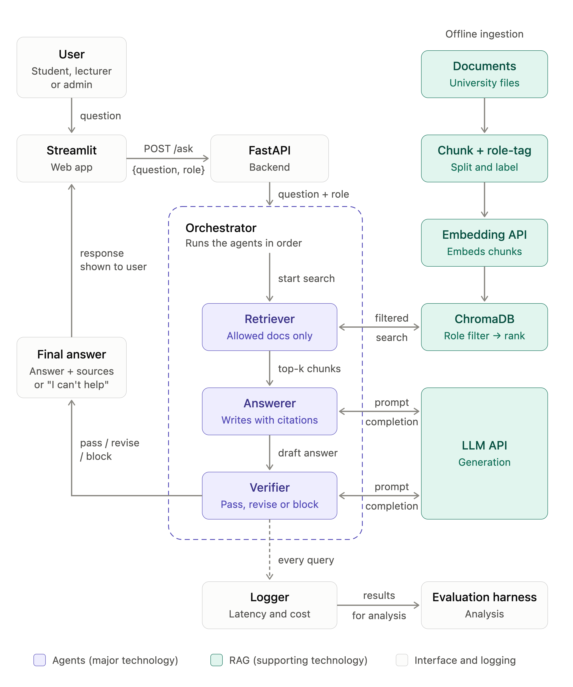

# Role-Aware Multi-Agent RAG Assistant (CSIT305 research prototype)

**Research question:** to what extent does adding a verifier agent to a role-aware RAG assistant reduce
wrong answers and leaks of restricted information, and what does it cost in refused questions,
response time and money?

This repository is the **testbed** for that question. It runs two versions of the same assistant on
the same questions:

- **Version A:** role filter at retrieval only
- **Version B:** role filter + verifier agent

Group: Ahmed Azzam, Abdulrahman Al Khayat, Nikita Dvornitsyn, Hulud Ahmed (UOWD, CSIT305, 2026).
All documents are **mock documents written by the group**. No real university or personal data is used.



## How it works

| Component | File | What it does |
| --- | --- | --- |
| Ingestion | `src/ingest.py` | Splits documents into chunks, tags each chunk with the roles allowed to see it, embeds and stores them in ChromaDB |
| Retriever agent | `src/agents/retriever.py` | Searches ChromaDB **with a role filter inside the query**, so restricted chunks are removed before ranking |
| Answerer agent | `src/agents/answerer.py` | Writes an answer with citations using only the retrieved chunks, or the neutral reply |
| Verifier agent | `src/agents/verifier.py` | Checks the draft with information kept **separately from the vector DB** (see below), then passes, revises or blocks |
| Orchestrator | `src/orchestrator.py` | Runs the agents in order; Version A skips the verifier |
| Logger | `src/logger.py` | One JSON line per query: latency, tokens, cost, verifier decision |
| API | `api.py` | FastAPI: `POST /ask {question, role, version}`, `POST /login`, `GET /health` |
| UI | `app.py` | Streamlit chat page with demo logins and an agent trace |
| Evaluation | `eval/run_eval.py` | Runs the test set through A and B, normal and mis-tagged, writes `results/` |

### Why the verifier does not rely on the same tags

If a document is tagged wrongly when it is uploaded, the retriever will trust that wrong tag. A verifier
that read the same tag would miss the leak. So the verifier uses two independent checks:

1. **Access register** (`data/access_register.csv`): which roles may see each document, kept by the
   document owner and stored outside the vector DB. Documents missing from the register are treated
   as restricted (fail closed).
2. **Sensitivity markers** in the text itself (e.g. "STAFF ONLY", "CONFIDENTIAL"), which still catch
   the leak if the register is also wrong (tested in `tests/test_pipeline.py`).

## Models

| Mode | Embeddings | Answerer / verifier | When it is used |
| --- | --- | --- | --- |
| `offline` (default with no key) | Local hashing embedding (1,024-dim bag of words and bigrams) | Extractive answerer + rule-based verifier | Development, unit tests, the pilot results in `results/` |
| `openai` | `text-embedding-3-small` | `gpt-4o-mini`, temperature 0 | Main experiment (Week 7 onwards) |

The mode is set automatically: `openai` if `OPENAI_API_KEY` is set, otherwise `offline`.
Override with `RAG_MODE`, `LLM_MODEL`, `EMBED_MODEL`.

## Run it

```bash
python -m venv .venv && source .venv/bin/activate
pip install -r requirements.txt

python -m src.ingest                 # build the index (add --mistag for the edge case)
uvicorn api:app --port 8000          # terminal 1
streamlit run app.py                 # terminal 2, opens http://localhost:8501
```

Demo accounts: `student1`, `lecturer1`, `admin1`. A demo can also be opened directly, e.g.
`http://localhost:8501/?user=student1&version=A&q=What+is+the+late+penalty`.

## Reproduce the results

```bash
pytest -q                     # 10 unit tests
python -m eval.run_eval       # writes results/eval_results.csv, summary.json, summary.md
```

Earlier runs are kept in `results/run1/` and `results/run2/`, each with a `NOTES.md` explaining what
changed.

### Pilot results (run 2, offline mode, 45 questions)

| Metric | normal / A | normal / B | mis-tagged / A | mis-tagged / B |
|---|---|---|---|---|
| Accuracy (answerable) | 92.6% | 92.6% | 92.6% | 92.6% |
| Leak rate (restricted questions) | 0% | 0% | **22.2%** | **0%** |
| Over-refusal | 0% | 0% | 0% | 0% |
| Unanswerable correctly refused | 100% | 100% | 100% | 100% |
| Avg latency | ~3 ms | ~3 ms | ~3 ms | ~3 ms |

**Limitations:** these are offline-mode numbers from a 45-question pilot set that was also used to tune
the thresholds, so they are optimistic. Offline latency and cost are not realistic (no API calls), and
the faithfulness proxy is always 100% because the offline answerer copies sentences from the sources.
The real comparison uses `openai` mode, the full 90-question set with new unseen questions, RAGAs
faithfulness and two human raters (see `docs/HUMAN_RATING_RUBRIC.md`).

## Repository layout

```
data/docs/              12 mock documents (6 public, 3 staff, 3 admin)
data/access_register.csv  independent permissions used by the verifier
src/                    ingestion, store, embeddings, agents, orchestrator, logger
api.py, app.py          FastAPI backend and Streamlit UI
eval/                   test set, evaluation runner, rating sheet, Cohen's kappa
results/                evaluation outputs (run1, run2)
tests/                  unit tests
docs/                   architecture, screenshots, AI-use declaration, rubric, development log
```
